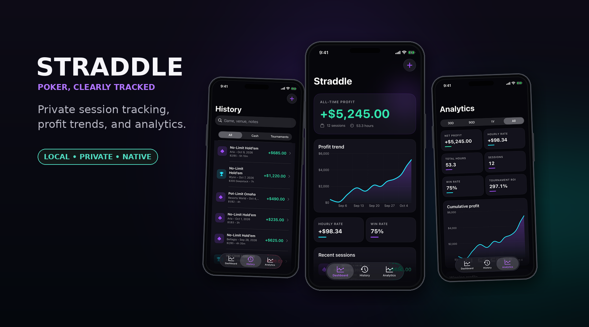
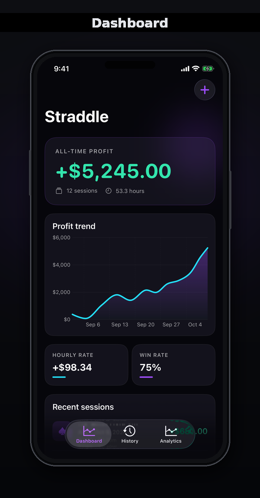
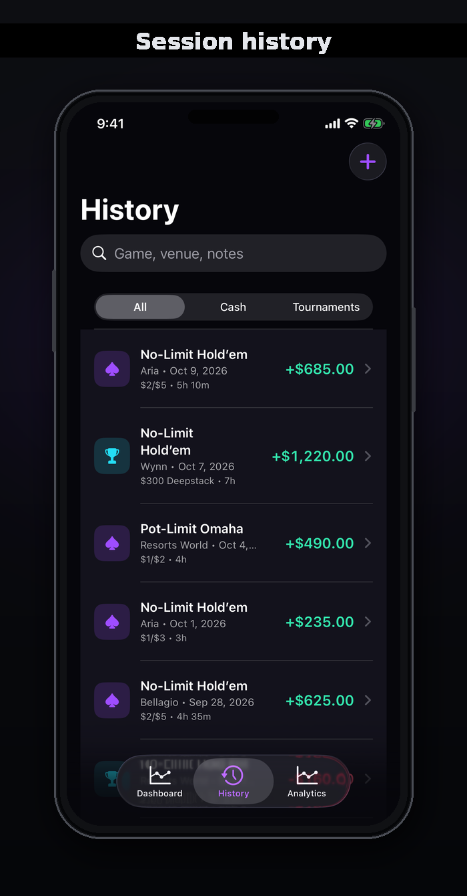
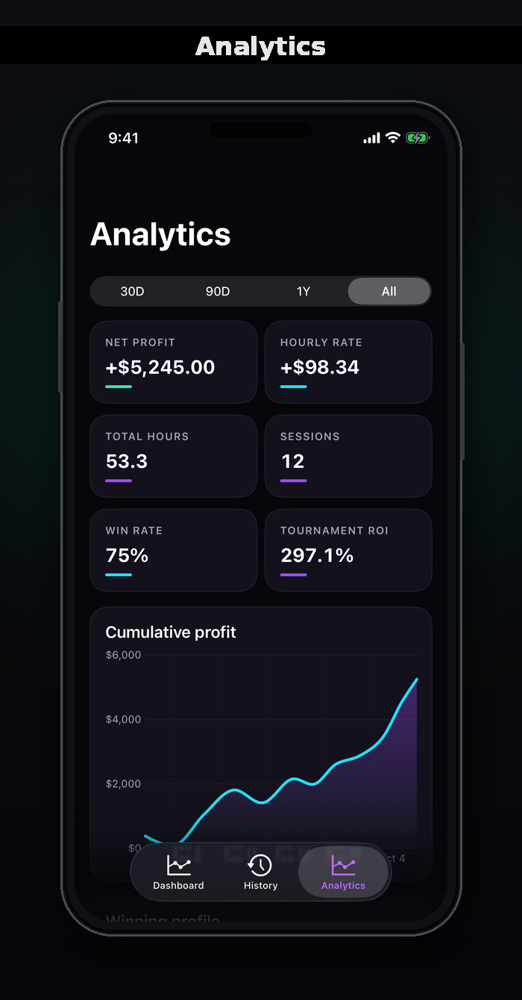

# Straddle

Straddle is a privacy-first, local-only iPhone app for tracking poker sessions, profit, bankroll trends, and performance analytics.

<p align="center">
  
</p>

<p align="center"><em>Real SwiftUI screens rendered with synthetic demonstration sessions. No personal poker data is shown.</em></p>

## Interface

<p align="center">
  
  &nbsp;
  
  &nbsp;
  
</p>

## Features

- Cash-game and tournament session tracking
- Fast entry for date, game, stakes, venue, buy-in, cash-out, and duration
- Cumulative profit chart and all-time dashboard
- Hourly rate, total hours, session count, win rate, average win/loss, and best/worst sessions
- Cash-versus-tournament results and tournament ROI
- Venue and game performance breakdowns
- Searchable, editable session history
- Premium near-black interface with restrained electric-purple and cyan accents

## Privacy and architecture

Straddle is a self-contained native iOS app. It has no server, account system, advertising, analytics SDK, cloud service, or network client.

Session data is encoded as JSON and stored only inside the app's private Application Support container. Calculations and charts are produced locally on the phone. Standard iPhone backups may include the app container depending on the user's backup settings, but Straddle does not implement cloud synchronization or its own backup service.

Deleting the app deletes its local data unless that data can be recovered from an iPhone backup.

## Technology

- Swift 5.10
- SwiftUI
- Swift Charts
- Foundation and Combine
- XcodeGen
- iOS 17.0+

There are no third-party runtime dependencies.

## Repository layout

```text
Straddle/
├── Analytics/       # Metrics, trends, ROI, and breakdown calculations
├── App/             # SwiftUI application entry point and root navigation
├── Components/      # Shared UI components
├── Models/          # Codable poker-session model
├── Resources/       # Asset catalog and app icon
├── Services/        # Local JSON persistence
├── Theme/           # Colors and shared visual styling
└── Views/           # Dashboard, history, analytics, and session forms
StraddleTests/       # Analytics and persistence tests
project.yml          # XcodeGen project definition
```

## Prerequisites

- A Mac with Xcode installed
- [XcodeGen](https://github.com/yonaskolb/XcodeGen)
- An iOS 17+ simulator, or an iPhone configured for development
- An Apple Developer team for physical-device signing

Install XcodeGen with Homebrew:

```bash
brew install xcodegen
```

## Build and test

```bash
git clone https://github.com/Cammm123/Straddle.git
cd Straddle
xcodegen generate
xcrun simctl list devices available
xcodebuild -project Straddle.xcodeproj -scheme Straddle \
  -destination 'platform=iOS Simulator,name=iPhone 17' test
```

Choose an available simulator name if `iPhone 17` is not installed.

You can also open the generated project:

```bash
open Straddle.xcodeproj
```

## Configure signing for your own device

The checked-in Apple Team ID and bundle identifiers are public application identifiers, not credentials. Forks should replace Cameron's values in `project.yml`:

- `DEVELOPMENT_TEAM`
- `bundleIdPrefix`
- `PRODUCT_BUNDLE_IDENTIFIER` for `Straddle`
- `PRODUCT_BUNDLE_IDENTIFIER` for `StraddleTests`

Use bundle identifiers registered to your own Apple Developer account, regenerate the project, select your connected iPhone as the destination, and run the `Straddle` scheme from Xcode.

```bash
xcodegen generate
```

The generated `Straddle.xcodeproj` is a local build artifact and is intentionally not committed.

## Data storage

The app stores sessions in its private Application Support directory under:

```text
Straddle/sessions.json
```

Writes are atomic. Dates use Foundation's reference-date representation so save/load round trips preserve exact values.

## Tests

The test suite covers:

- Core profit and hourly-rate calculations
- Cumulative trends and time-range filtering
- Venue and game breakdowns
- Empty analytics behavior
- Session save, reload, update, and deletion

Run it with the `xcodebuild` command above or from Xcode's Test navigator.

## License

Straddle is available under the [MIT License](LICENSE).
